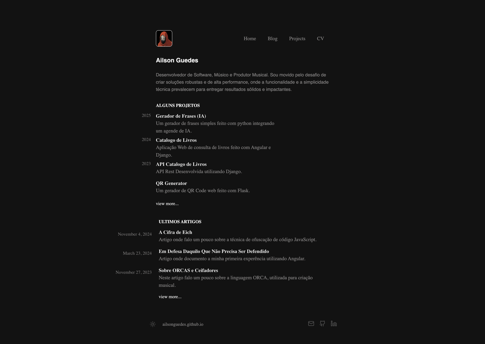
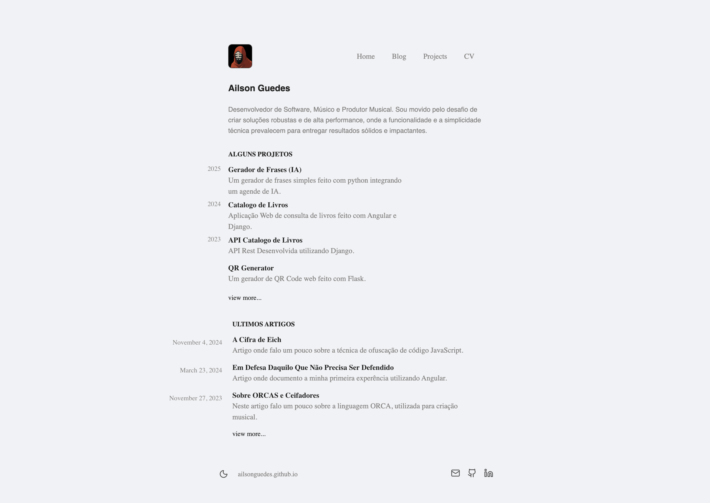

# Meu Portfólio Web Pessoal

Bem-vindo ao meu portfólio web! Este projeto é o hub central para a **exposição do meu trabalho**, atuando como um repositório de **projetos de desenvolvimento**, **artigos de tecnologia** e demonstrações da minha atuação como **produtor musical** em áreas que se interconectam com o universo tech.

## Propósito e Conteúdo

Este portfólio não apenas exibe minhas habilidades técnicas, mas também busca **integrar minhas diferentes paixões**. O objetivo é apresentar uma visão completa do meu conhecimento e criatividade, destacando:

* **Projetos de Desenvolvimento:** Demonstração das minhas competências em engenharia de software e desenvolvimento front-end.
* **Artigos e Insights:** Espaço para compartilhar aprendizados e reflexões sobre o cenário tecnológico atual.
* **Conexão Musical:** Seção dedicada a projetos de produção musical que possuem influência ou relação com a tecnologia e programação.

## Tecnologias Utilizadas

O projeto foi construído utilizando uma **stack moderna e eficiente**, garantindo um desenvolvimento tipado, rápido e com alta performance:

| Categoria | Tecnologia | Objetivo |
| :--- | :--- | :--- |
| **Framework** | **React** | Construção da interface de usuário modular e reativa. |
| **Tooling** | **Vite** | Empacotamento de alto desempenho e ambiente de desenvolvimento rápido (HMR). |
| **Linguagem** | **TypeScript** | Adiciona tipagem estática, aumentando a qualidade e a manutenibilidade do código. |

## Funcionalidades Principais

* **Design Responsivo:** Layout adaptável para desktop, tablets e smartphones.
* **Temas light e dark (Toggle):** Alternância instantânea entre modos de visualização para melhor conforto do usuário.
* **Seção de Projetos:** Exposição dos projetos carregados pela API do backend.
* **Currículo:** Experiências profissionais carregadas pela API do backend.
* **Blog/Artigos:** Espaço dedicado para artigos técnicos e reflexões sobre tecnologia.

## Integração com o backend

O frontend consome `GET /api/v1/public_projects`, `GET /api/v1/experiences` e
`GET /api/v1/articles`.
Por padrão, a API é esperada em `http://localhost:5000/api/v1`. Para usar outra
URL, defina `VITE_API_BASE_URL` no ambiente do Vite (consulte `.env.example`).
Configure também `FRONTEND_ORIGIN` no backend para permitir a origem do frontend
via CORS. A seção de artigos carrega os dados do endpoint público de artigos.

As tags de tecnologias no currículo e nos projetos são reconhecidas pelo catálogo
Simple Icons, incluindo aliases e diferenças de maiúsculas ou espaços. Os ícones
são carregados do jsDelivr; nomes não encontrados ou falhas de carregamento são
indicados com `?`. Na área de trabalho, passe o cursor sobre a tag para ver o
ícone; em telas sem hover, ele aparece ao lado do nome.

O site usa `HashRouter` para permitir acesso direto às rotas no GitHub Pages.
As URLs públicas incluem `/#/`: artigos em `/#/articles` e detalhes em
`/#/articles/:name`; cada card consulta o artigo pelo título usando
`GET /api/v1/articles?name={name}`. O campo `text` pode conter o conteúdo em
Markdown, e `link` pode apontar para a publicação original.

Os projetos ficam em `/#/projects` e seus detalhes em `/#/projects/:name`,
consultando o projeto pelo título usando
`GET /api/v1/public_projects?name={name}`. O currículo fica em `/#/cv`. O campo
`description` é o resumo; `text` é opcional e pode conter a descrição longa em
Markdown. A página também apresenta tecnologias e o conteúdo do projeto quando
esses dados estiverem disponíveis. Para incluir um link externo, adicione-o ao
campo `text`, por exemplo:

```markdown
[Ver projeto](https://exemplo.com)
```

Para exibir a linguagem e o botão de cópia em um bloco de código, escreva a
linguagem após a abertura e coloque o código nas linhas seguintes:

````markdown
```bash
cd projeto
```
````

Blocos sem linguagem também têm botão de cópia. Imagens Markdown recebem moldura
e se ajustam à largura disponível.

O campo `text` também aceita HTML, por exemplo `<br>`, `<strong>`, `<details>`,
`` e iframes de vídeo. Iframes são limitados a embeds HTTPS do YouTube,
YouTube NoCookie, Vimeo, TikTok e Instagram; outras origens e atributos não
permitidos são removidos pelo sanitizador. Use a URL oficial de incorporação,
como:

```html
<iframe
  src="https://www.youtube.com/embed/VIDEO_ID"
  title="Título do vídeo"
></iframe>
```

Scripts, estilos inline e atributos de eventos também são removidos. Imagens e
links HTML recebem o mesmo tratamento visual e de segurança dos equivalentes
em Markdown.

## Galeria de Imagens: Temas de Interface

Para demonstrar a flexibilidade do design e acessibilidade, o portfólio possui modos de tema light e dark.

| Modo Dark | Modo Light |
| :---: | :---: |
|
<div style="display: flex; justify-content: space-around;">
    
    
</div>

<br>

**Desenvolvido por:** [Ailson Guedes / [@ailsonguedes](https://github.com/ailsonguedes)]
